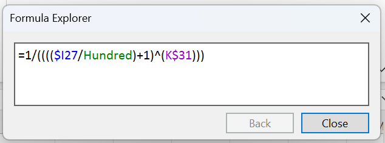
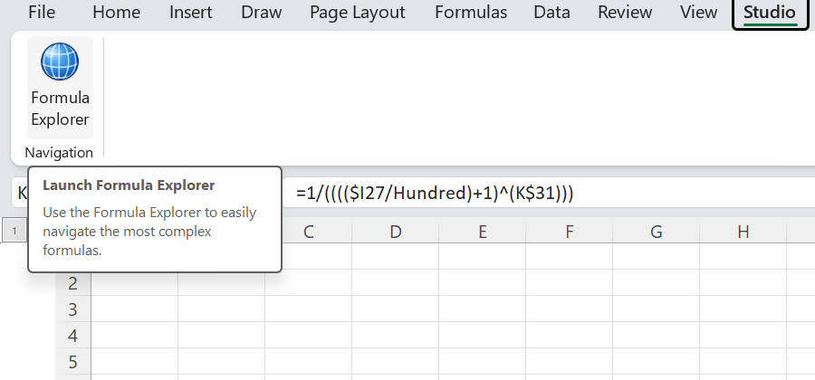
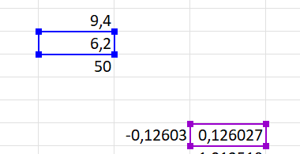
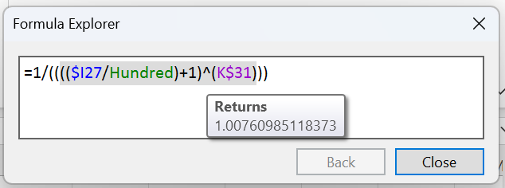
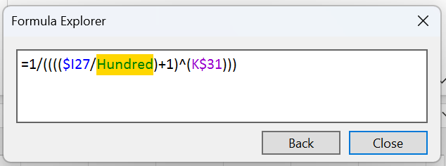
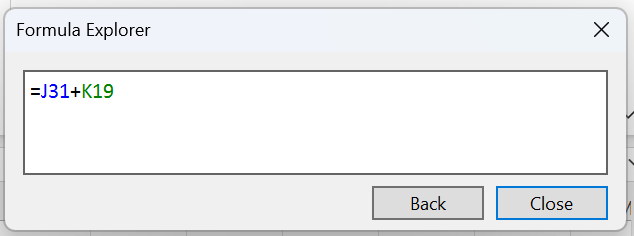
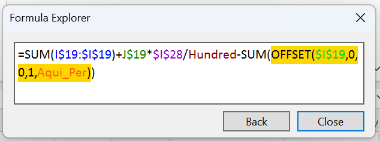

# Formula Explorer for Excel

Formula Explorer helps you read and navigate long Excel formulas.

It is a re-creation of the Formula Explorer from **Spreadsheet Studio**, an Excel add-in from 2011–2013 that is no
longer available. This version runs in today's Excel (Microsoft 365, 64-bit).



With Formula Explorer you can:

- see each reference in its own color,
- see the precedent cells outlined in the same color on the sheet,
- point at any part of a formula and see what it returns,
- click a reference to go to it (and, if that cell has a formula, to open it),
- go back step by step.

---

## 1. Install

You need:

- Windows 10 or 11
- Excel for Microsoft 365 (desktop, **64-bit**)

Steps:

1. Download **FormulaExplorerSetup.exe** from the [Releases](../../releases) page.
2. Close Excel.
3. Run `FormulaExplorerSetup.exe` and click **OK**.
   - You do not need administrator rights.
   - If the **.NET 10 Desktop Runtime** is missing, the setup offers to install it. Click **Yes**.
4. Open Excel.

> **Windows protected your PC?** The setup file is not digitally signed. Click **More info › Run anyway**.

## 2. Open Formula Explorer

1. Select a cell that has a formula.
2. Go to the **Studio** tab (after **View**).
3. Click **Formula Explorer**.



A small window opens with the formula of the selected cell:

- Each reference has its own color.
- Functions, numbers and operators stay black.
- The same reference always gets the same color.

## 3. See the precedents on the sheet

The cells that the formula uses are outlined on the sheet in the same colors as in the formula.



The borders follow scrolling, zoom and frozen panes. They never change your workbook, and they disappear when you
close the window.

## 4. Point at any part of the formula

Move the mouse over any part of the formula:

- The part you point at turns gray.
- After a moment, a **Returns** tooltip shows its value.



What gets highlighted depends on what is under the mouse:

| Under the mouse | Highlighted part |
|---|---|
| a reference or a name | that reference |
| an operator (`+ - * / ^ &` …) | the whole operation, following Excel's order of calculation |
| a parenthesis | the whole group inside the parentheses |
| a function name | the whole function call |

Ranges show their address and values, for example:

```
I19:J19 containing
[1x2] , 0.252054794520548
```

## 5. Click to go to a reference

Click a reference, a name, or a function that returns a range (like `OFFSET` or `INDEX`). One click is enough:

- Excel selects that cell or range, even on another sheet.
- If the target is a single cell **with a formula**, the window immediately shows **that cell's formula** (see step 6).
- Otherwise (a range, a constant or an empty cell), the part you clicked turns **gold** and the formula in the window
  stays the same, so you can click other parts.



If the target is on a hidden sheet or in a collapsed group, Formula Explorer shows it for you. It hides it again when you
move on.

## 6. Open a precedent's formula

Click a reference whose cell has a formula. The window now shows **that cell's formula**, and the selection in Excel
moves to that cell. There is nothing else to do: a single click navigates and opens it in one go.



Keep going as deep as you need:



If you double-click out of habit, it still goes only one level down: the second click is ignored.

## 7. Go back and close

- **Back** retraces your steps:
  - If something is gold (you clicked a range or a value), Back returns the selection to the formula's cell.
  - Otherwise, Back returns to the previous formula.
- **Close** (or **Esc**) closes the window. Excel keeps the current selection.

Also good to know:

- When you select another cell in Excel, the window follows it. **Back** returns to the previous cell.
- The window can be resized. It remembers its size and position.
- Cells without a formula show their value in black.

---

## Uninstall

Open **Settings › Apps › Installed apps**, find **Formula Explorer for Excel**, and click **Uninstall**.

## Limits

- Dynamic array (spill) formulas are not supported.
- Only 64-bit Excel for Windows. Excel Online and Mac are not supported.
- A part of a formula longer than 255 characters cannot be evaluated. The tooltip shows `[Unable to evaluate]`.
- While you are editing a cell, clicks in the window are ignored, so your edit is not committed by accident.

---

## For developers

Built with [Excel-DNA](https://excel-dna.net) 1.9, .NET 10 and WPF. The precedent borders are drawn on a transparent
Win32 layer.

| Folder | What is inside |
|---|---|
| `src/FormulaExplorer.Core` | formula tokenizer, parser, colors, value formatting (no Excel needed) |
| `src/FormulaExplorer.AddIn` | Excel add-in: ribbon, window, Excel access, overlay |
| `tests/` | unit tests and real-Excel integration scripts |
| `tools/FormulaExplorer.Setup` | the installer |
| `docs/` | behavior research and architecture notes (in Portuguese) |

Build and test:

```powershell
dotnet build FormulaExplorer.slnx
dotnet test FormulaExplorer.slnx
.\scripts\build-setup.ps1   # creates dist\FormulaExplorerSetup.exe
```

You need the .NET 10 SDK.

Integration tests:

- `tests/integration/Run-Scenarios.ps1` drives a real Excel with the mouse and keyboard.
- It uses test hooks that load only when `HKCU\Software\FormulaExplorer\EnableTestHooks = 1`.
- The visual comparison scenario (S20) needs the original reference frames. They are third-party material and are not
  part of this repository.
